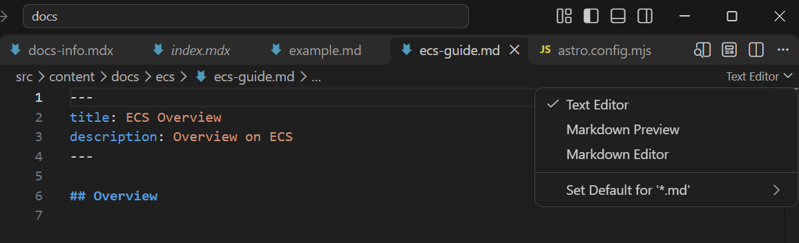
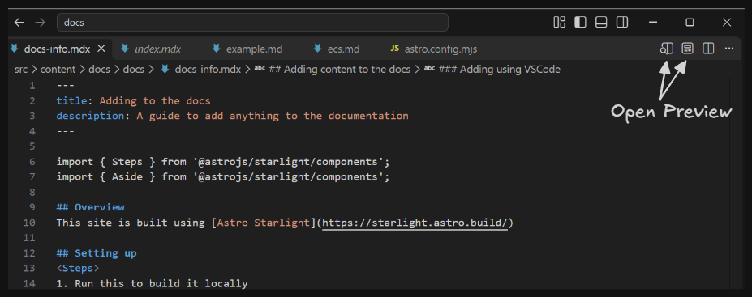
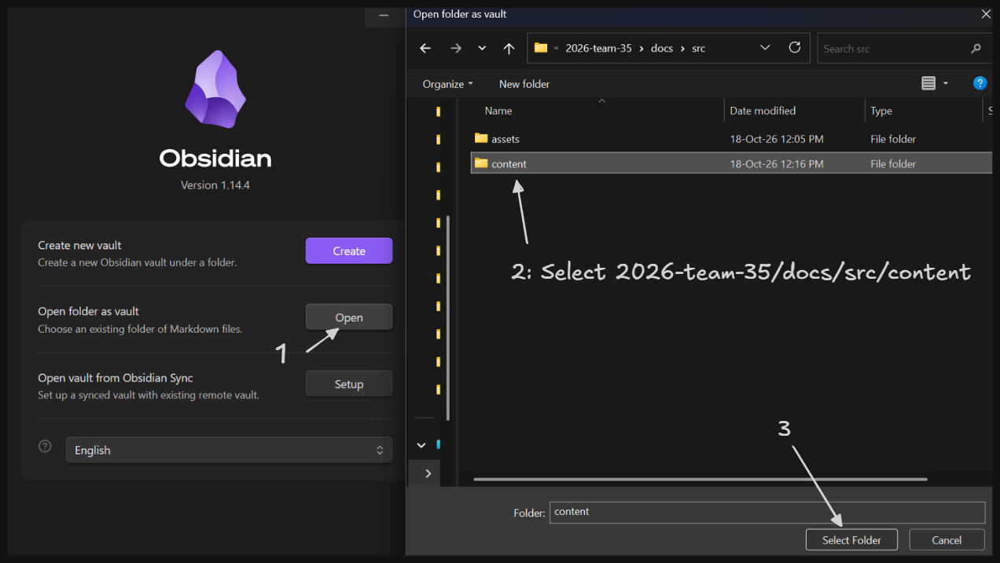

import { Steps } from '@astrojs/starlight/components';
import { Aside } from '@astrojs/starlight/components';
import { FileTree } from '@astrojs/starlight/components';
import { Card } from '@astrojs/starlight/components';

## Overview
This site is built using [Astro Starlight](https://starlight.astro.build/)

## Setting up
<Steps>
1. From the root folder (`2026-team-35`), run this to build it locally:
    ```sh
    cd docs && npm i
    ```

2. Then run this to start the server:
    ```sh
    npm run dev
    ```
    By default, it should open on: http://localhost:4321/

    While this is running, it supports hot-reloading, so any changes you make will be automatically refreshed in the browser.
</Steps>

## Adding content
You can write and edit documentation using various Markdown editors. I'll show 2 ways that I use, using [VSCode](#editing-using-vscode) and [Obsidian](#editing-using-obsidian). Both of these are Markdown editors which is the internal format used by Astro. 

To add, any files, go to `2026-team-35/docs/src/content/` and add a folder for the topic, then add the `.md` or `.mdx` files in that folder.
<FileTree>
- 2026-team-35 project root
    - docs documentation root
        - src
            - content
                - ECS/ should be on the same level as this
                - `Topic Folder`
                    - **file-1.md**
                    - **file-2.mdx**
</FileTree>

File extensions:
- `.md` is the standard Markdown file extension
- `.mdx` is an extension of `.md`, Astro allows other [components](https://starlight.astro.build/components/using-components/#using-a-component-in-mdx) to be used

At the top of the file, it needs to have this frontmatter:
```md
---
title: <Your page title>
description: <Your page description>
# ... other frontmatter (like sidebar.order). See Astro's docs
---
```

This is metadata for Astro to process. From [Astro's docs](https://starlight.astro.build/reference/frontmatter/):
- **title**: You must provide a title for every page. This will be displayed at the top of the page, in browser tabs, and in page metadata.
- **description**: The page description is used for page metadata and will be picked up by search engines and in social media previews.

Description isn't really needed for us but I think its a good practice, can omit it if you want.

### Markdown format
Markdown is a widely used documentation format. It's supported by [GitHub](https://docs.github.com/en/get-started/writing-on-github/getting-started-with-writing-and-formatting-on-github/basic-writing-and-formatting-syntax) and many LLMs also use this format internally. 

There are various 'flavors' of Markdown, so try to reference [Astro's Markdown syntax](https://starlight.astro.build/guides/authoring-content/). Astro also has several [components](https://starlight.astro.build/components/using-components/) that aren't in the standard markdown syntax, these need the `.mdx` format.

### Editing using VSCode
<Aside type='caution'>
VSCode started adding markdown preview support recently, so it might be slightly buggy.
</Aside>

Open any `.md` file. On the top right, it should show this:


- Text Editor: Shows the raw text
- Markdown Preview: Shows the rendered result. Unable to edit
- Markdown Editor: Shows the rendered result, hides formatting hints by default, only shows them when the cursor is on the line.

Note: The dropdown toggle is currently only supported for `.md` files, not `.mdx`. For `.mdx` files, use this instead:


Links: 
- [VSCode markdown](https://code.visualstudio.com/Docs/languages/markdown)

### Editing using Obsidian
[Obsidian](https://obsidian.md/download) is a powerful Markdown editor, but it does **not natively support the `.mdx` format** so you can't use [Astro's components](https://starlight.astro.build/components/using-components/). There's a few community [Obsidian Plugins](https://community.obsidian.md/search?q=mdx) but I haven't tried any.

Personally, I think Obsidian is a better markdown editor compared to VSCode, but need to install another program.

<Steps>
1. Install [Obsidian](https://obsidian.md/download)

2. Open `2026-team-35/docs/src/content` as vault

3. Done! Can start editing the docs now. Note as mentioned above, `.mdx` won't be showed in the sidebar in Obsidian.
</Steps>

<Aside type='caution' title='Caution: Obsidian syntax difference - line breaks'>
Obsidian treats single line breaks differently than standard Markdown and Astro.

**Example Input:**
```md
Line 1
Line 2

Line 3
```

<Card title='Obsidian renders as:'>
Line 1 <br /> Line 2

Line 3
</Card>

<Card title='Astro renders as:'>
Line 1
Line 2

Line 3
</Card>

If you just want 1 line break, use `<br />`
</Aside>

<Aside type='caution' title='Caution: Obsidian syntax difference - callouts'>
[Obsidian has callouts](https://obsidian.md/help/callouts), but they aren't supported in Astro. Astro uses [Asides](https://starlight.astro.build/components/asides/) instead.

This Caution block is an Aside!
</Aside>
